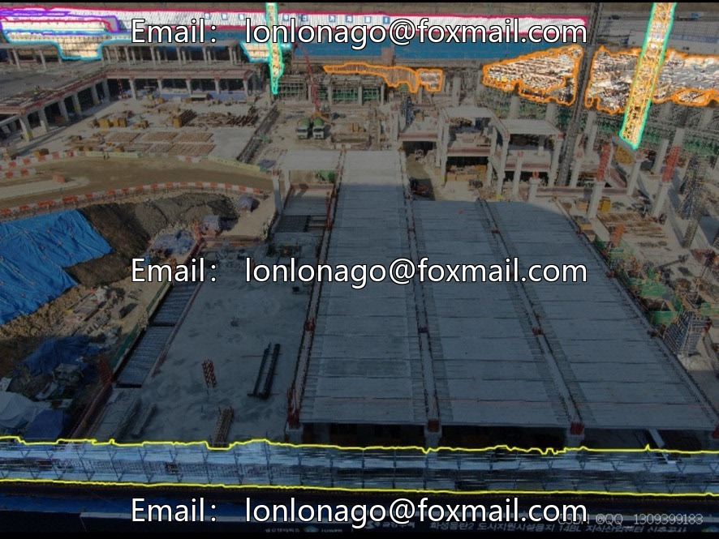
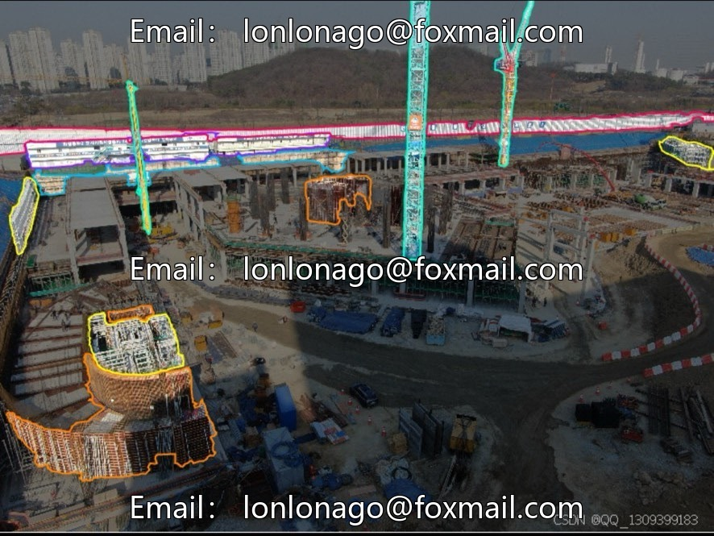
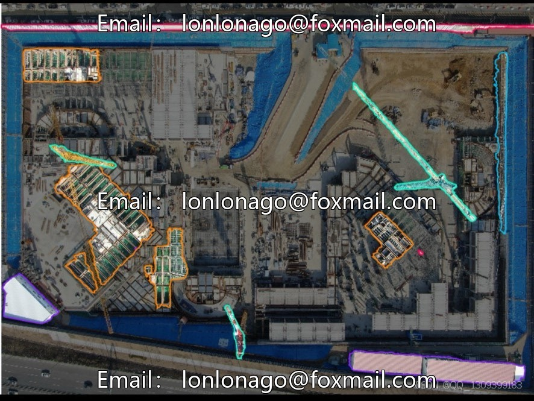
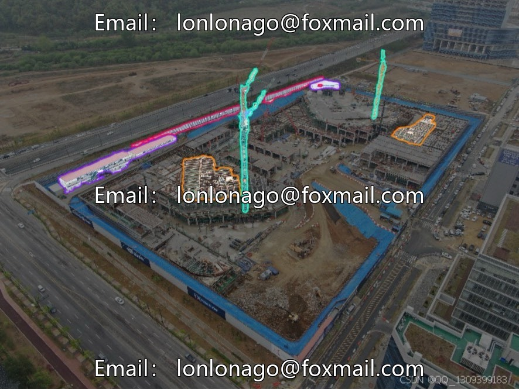
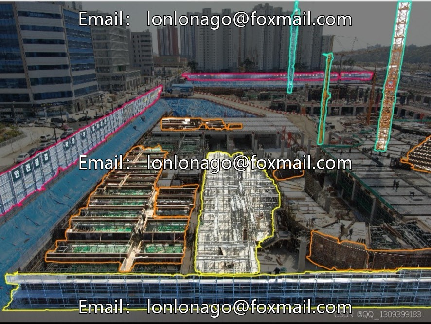
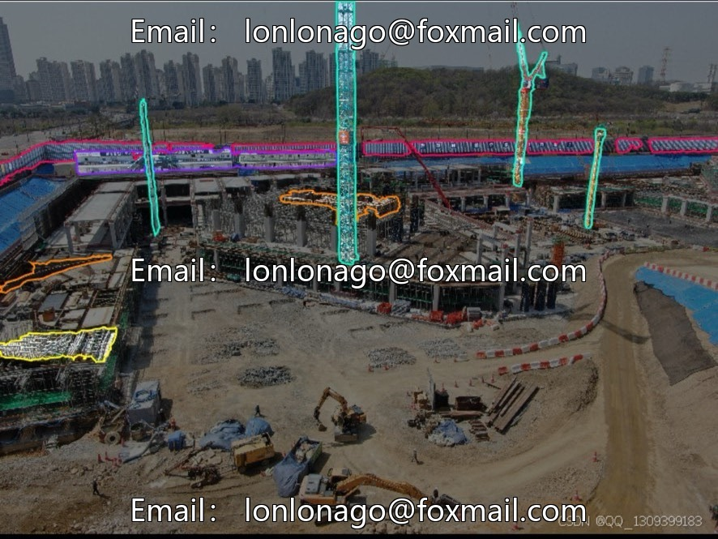

# UAV aerial photography of construction site dataset example segmentation (Issue 10089)

## Body

UAV aerial photography of construction site dataset example segmentation (Issue 10089)

The dataset consists of 153 aerial images of construction sites, covering six core construction objectives: support, equipment, fence, formwork, office, scaffolding. It is suitable for scenarios such as construction safety monitoring, progress management, intelligent inspection, etc.

Dataset specifications
- Task type: instance segmentation
- Total number of images: 153
- Number of categories: 6 classes
- Supported models: None

The dataset is small, suitable for learning with small samples or data augmentation. The category settings are close to construction reality, which can quickly establish a baseline segmentation model for the construction site scene.

Virtual materials, once sold, are non-refundable.
Interested friends, click "I want" to proceed.

## Images

## Payment

Here is a pay link on Stripe ( https://buy.stripe.com/3cs8yP7sY87d0vu9AB ). Please contact me lonlonago@foxmail.com after funding $89, and I will send you a complete data files , thank you!

